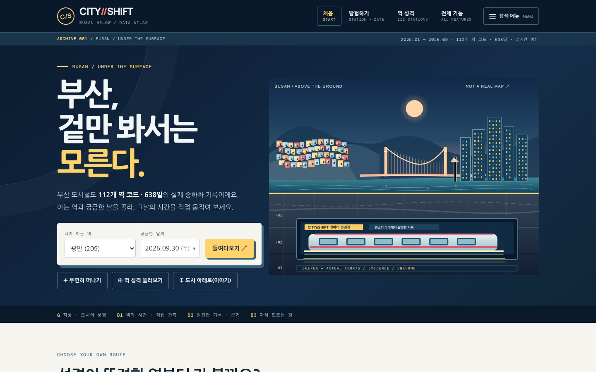
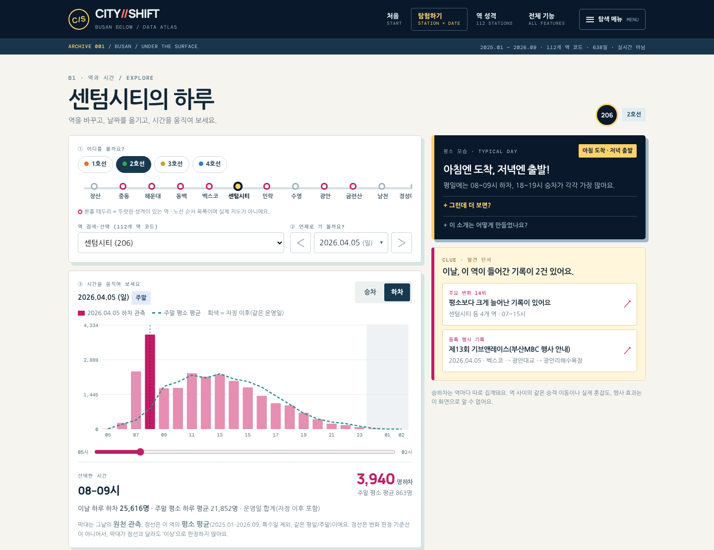
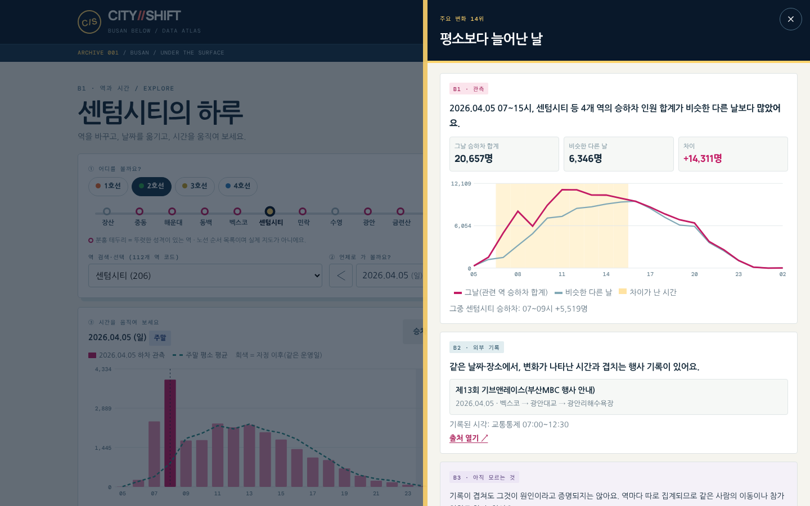
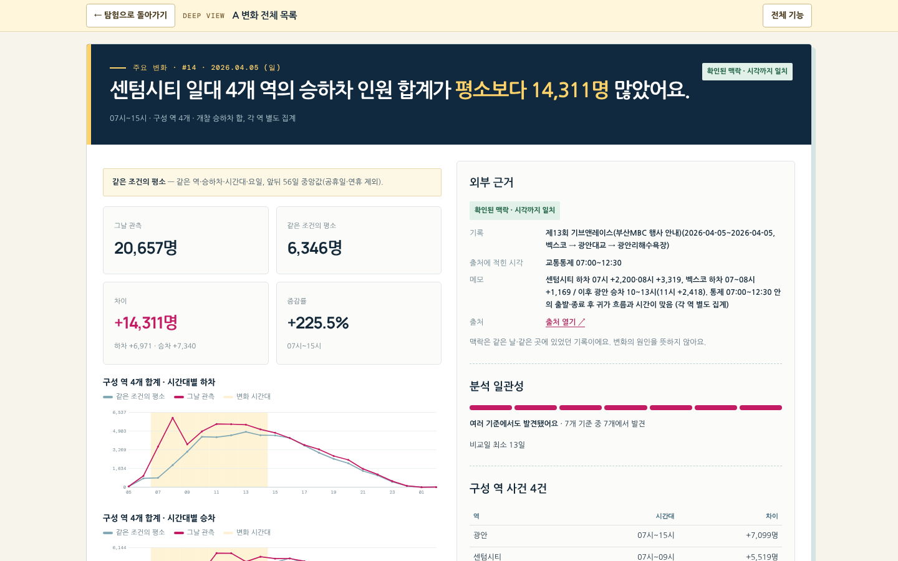
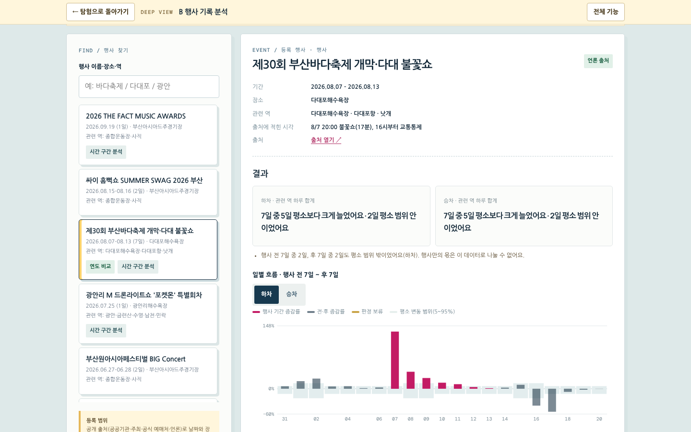
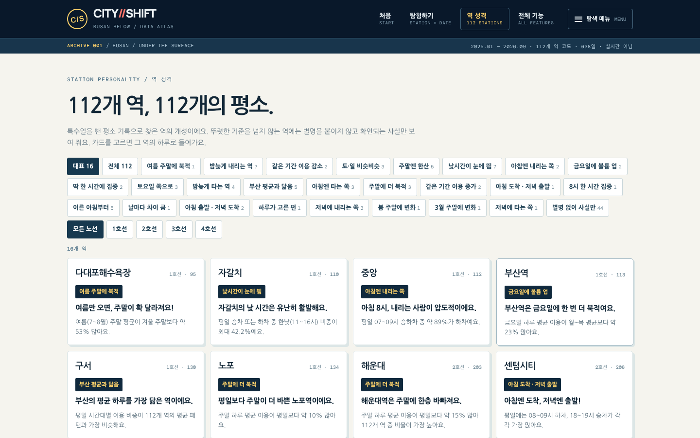
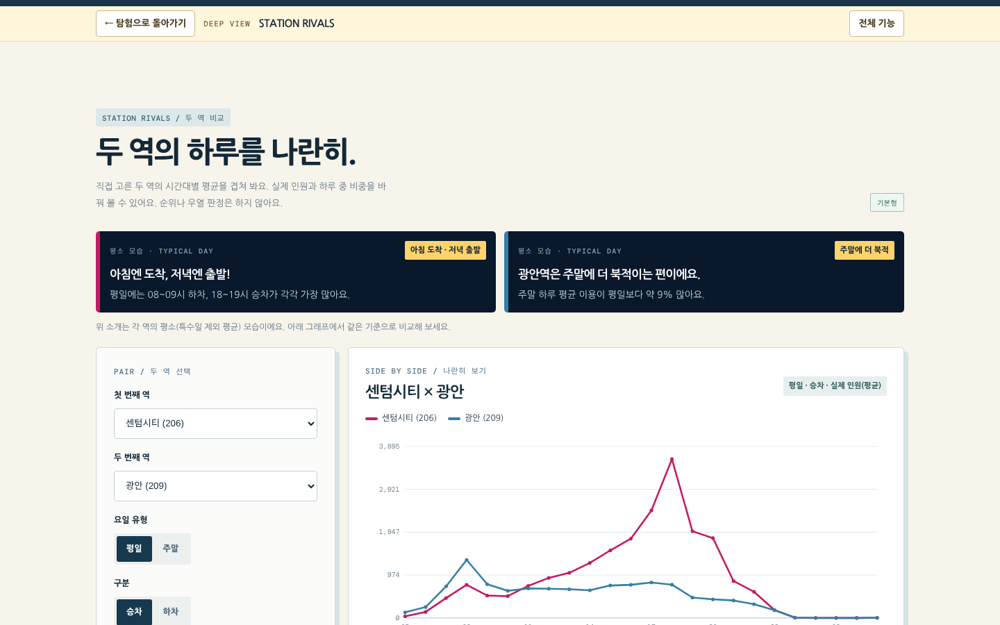
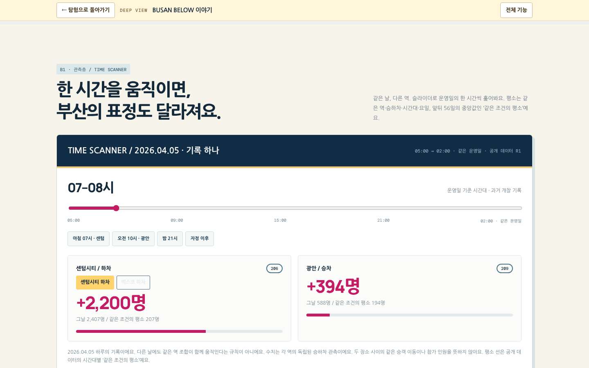

# CITY//SHIFT — BUSAN BELOW

**부산, 겉만 봐서는 모른다.**

부산 도시철도 112개 역 코드, 638일의 시간대별 승하차 기록을 역·날짜·시간 단위로 직접 들여다보는 웹 아틀라스입니다.

### [▶ 서비스 열기 — justman-yzz.github.io/city-shift](https://justman-yzz.github.io/city-shift/)

[사용자 가이드](docs/USER_GUIDE.md) · [데이터와 분석 방법](docs/DATA_AND_METHODS.md) · [아키텍처](docs/ARCHITECTURE.md) · [검증 기록](docs/TEST_REPORT.md) · [변경 이력](CHANGELOG.md)



> **먼저 알아 둘 점**
> - 실시간 정보가 아닙니다. 2025-01-01 ~ 2026-09-30의 과거 개찰 기록입니다.
> - 숫자는 역마다 따로 센 승차·하차 인원입니다. 둘을 더한 **승하차 인원 합계**는 서로 다른 사람의 수가 아니며, 누가 어디서 어디로 갔는지도 알 수 없습니다.

---

## 탐험하기

**① 역과 날짜를 고릅니다.** 처음 화면에서 아는 역과 궁금한 날을 고릅니다. '우연히 떠나기'를 누르면 무작위 역·날짜로 갑니다.

**② 시간을 움직입니다.** 막대는 그날의 원천 관측, 점선은 그 역의 평소 평균입니다. 슬라이더를 끌거나 막대를 누르면 그 시간의 숫자가 나옵니다. 오른쪽 카드에는 이 역의 평소 성격이 한 줄로 나옵니다.



**③ 단서를 엽니다.** 그 역·그 날짜에 공개된 변화 기록이나 등록 행사가 있을 때만 단서가 나타납니다. 단서 창은 **B1 관측 · B2 외부 기록 · B3 아직 모르는 것** 세 칸으로 나뉩니다. 기록이 없는 날에는 "평범한 하루도 관측이에요"라고 알려 줍니다.



**④ 다음 역으로 넘어갑니다.** 하루 모양이 정반대인 역, 같은 기록에 함께 들어간 역, 이 역이 기록에 나온 다른 날이 추천됩니다.

탐험 화면의 주소는 그대로 공유할 수 있습니다.
예: [센텀시티 · 2026.04.05 · 하차 · 08–09시](https://justman-yzz.github.io/city-shift/#/explore?s=206&d=2026-04-05&g=a&h=3)

## 주요 기능

**A · 평소와 달랐던 순간** — 모든 역에 같은 기준을 적용해 데이터가 먼저 찾은 변화입니다. 주요 변화 50건(도시 전체 5건 포함), 특별한 날짜 20건, 이용 감소 20건.

**B · 행사 전후 비교** — 공개 출처로 확인한 행사 18건의 앞뒤 7일을 '행사가 없던 평소'와 비교합니다. 같은 행사의 2025·2026 연도 비교도 있습니다.

<p>


</p>

**역 성격 112** — 특수일을 뺀 평소 기록으로 찾은 역의 개성입니다. 기준을 넘은 68개 역에만 태그를 붙이고, 나머지 44개 역은 사실만 보여 줍니다.

**STATION RIVALS** — 두 역의 하루를 겹쳐 봅니다. 평일/주말, 승차/하차, 실제 인원/하루 중 비중을 바꿀 수 있습니다.

<p>


</p>

이 밖에 역 프로필, 원천 관측 표 조회와 CSV 불러오기가 있습니다. 화면별 사용법은 [사용자 가이드](docs/USER_GUIDE.md)에 있습니다.

## 왜 만들었나 — BUSAN BELOW

부산교통공사의 시간대별 승하차 자료는 누구나 받을 수 있지만, 112개 역 코드 × 638일 × 24시간 × 승차·하차, 모두 3,429,888개의 숫자로 된 표입니다. 표만 봐서는 어느 역의 평범한 하루가 어떤 모양인지, 어느 날 무엇이 달랐는지 보이지 않습니다.

CITY//SHIFT는 이 표를 **걸어 들어가는 공간**으로 바꾸려고 만들었습니다. 그 공간은 도시의 지층으로 되어 있고, 아래로 내려갈수록 확실한 것에서 불확실한 것으로 옮겨 갑니다.

| 층 | 이름 | 담긴 것 |
|---|---|---|
| **G** | 지상 · 도시의 풍경 | 겉으로 보이는 부산(상징적으로 그린 일러스트) |
| **B1** | 역과 시간 · 직접 관측 | 원천 기록의 숫자 그대로 |
| **B2** | 발견한 기록 · 근거 | 같은 날·같은 곳에 있었던 외부 기록과 그 확인 수준 |
| **B3** | 아직 모르는 것 | 원인, 이동 경로, 참가 인원처럼 이 데이터로 답할 수 없는 것 |

숫자로 확인되는 것과 확인되지 않는 것을 같은 높이에 두지 않는 것이 이 서비스의 원칙입니다. **BUSAN BELOW 이야기**에서는 2026년 4월 5일의 기록 하나를 스크린도어, 시간 스캐너, 근거층, 미지층 순서로 따라 내려갑니다.



## 데이터와 분석 기준

### 데이터

| 자료 | 출처 | 범위 |
|---|---|---|
| 시간대별 승하차 인원 | 부산교통공사, 공공데이터포털 데이터셋 3057229 (이용허락범위 제한 없음) | 2025-01-01 ~ 2026-09-30, 638일, 1~4호선 112개 역 코드 |
| 특수일 58일 | Python `holidays`(KR) 공휴일 + 명절·연휴 블록 수작업 지정 | 같은 기간 |
| 외부 사실 카탈로그 24건 | 공공기관·주최 측·공식 예매처·언론의 공개 자료 링크와 사실 요약 | 행사·공연·제도 |

- **역 코드 112개는 역 112개가 아닙니다.** 환승역(서면·연산·덕천·동래)은 노선별로 코드가 다르고, 수영(2·3호선)과 미남(3·4호선)은 한 코드로 합산돼 있습니다.
- 경전철·동해선, 기상 자료, 제3자 스포츠 일정 자료는 포함하지 않았습니다.
- 원천 CSV는 저장소에 다시 올리지 않았고, 관측값 전체를 서비스 페이지 안에 압축해 넣었습니다.

### 세 가지 '평소'

'평소'는 쓰임에 따라 세 가지이며, 서로 섞어 읽으면 안 됩니다.

| 화면 표기 | 쓰는 곳 | 기준 | 변화 판정 |
|---|---|---|---|
| 같은 조건의 평소<br>(단서 창: 비슷한 다른 날) | A 변화 목록, 시간 스캐너 | 같은 역·승하차·시간대·요일, 앞뒤 56일 중앙값, 특수일 제외 | 씀 |
| 행사가 없던 평소 | B 행사 분석 | 관련 역 합계, 같은 요일, 앞뒤 56일 중 특수일·카탈로그 행사일을 뺀 중앙값 | 씀 |
| 평소 평균 | 탐험 점선, 역 프로필, RIVALS, 역 성격 | 전체 기간 평일/주말 평균, 특수일 제외 | **쓰지 않음** |

### 판정 기준

- **A:** 이상 셀(z ≥ 4, 증감 ≥ 150, 배율 ≥ 1.5)을 이어 사건으로 묶고, 기준을 7가지로 바꿔도 다시 잡히는지 확인합니다.
- **B:** 평소 날끼리의 변동 범위(5-95백분위)를 벗어나면 '크게 늘었어요/줄었어요'로 판정합니다. 비교할 평소 날이 1-7일이면 판정 보류, 0일이면 판정 불가입니다.
- **외부 기록**은 같은 때·같은 곳에 있었다는 **맥락**이며 원인을 증명하지 않습니다.

계산식, 외부 근거 등급, 역 성격 산출 기준은 [데이터와 분석 방법](docs/DATA_AND_METHODS.md)에 있습니다.

### 기술 구조

```
부산교통공사 CSV
  → DuckDB 적재 · 특수일 · 기준선
  → 공개 데이터 생성(Python)  → data/*.csv
  → 역 성격 지표 계산 · 문구 검산
  → site/index.html  단일 HTML, 데이터 내장
```

- **서버가 없습니다.** 분석은 미리 Python·DuckDB로 끝내고, 결과와 원천 관측 전체를 HTML 한 파일(약 4.7MB)에 넣었습니다.
- 원천 관측값은 gzip으로 압축해 넣고 브라우저의 `DecompressionStream`으로 풉니다.
- 화면은 해시 주소(`#/explore?…`)로 나뉘어 뒤로 가기와 링크 공유가 됩니다.
- 공개 저장소에는 허용 목록(`ALLOWLIST.txt`)에 적힌 파일만 올립니다.

## 검증과 한계

### 검증

| 검사 | 결과 |
|---|---|
| 공개 데이터 자동 검사 (`code/check_public.py`) | 122/122 통과. 공개 CSV·페이지 내장값을 원천 CSV와 대조, 내장 원천 3,429,888셀 전부 일치, 문서 이미지 10장 형식·메타데이터 검사 ([CHECK_RESULT.txt](CHECK_RESULT.txt)) |
| 화면 회귀·E2E (Playwright, 1440px·390px) | 주요 사용 흐름, A 90건·B 18건 상세 전체, 112개 역 성격 표시 확인. JS 오류 0, 가로 넘침 0 |
| 배포 환경 점검 | 압축 해제 불가 시 안내, 링크 공유, 뒤로/앞으로, 키보드, 터치(390px) |
| 역 성격 문구 검산 | 문구 속 수치·시간·역 이름 3,393개를 원천 재계산과 대조, 불일치 1건 수정 |

**아직 검증하지 않은 것:** iPhone Safari·삼성 인터넷 실기기, Firefox, 화면 낭독기. 자동 검사는 모두 데스크톱 Chromium에서 했습니다.

### 한계

- 개찰 집계입니다. 이동 경로(OD), 행사 참가 인원, 실제 혼잡도, 변화의 원인은 알 수 없습니다.
- 주요 변화 13건과 이용 감소 20건은 외부 기록을 아직 조사하지 않았습니다(화면에 '외부 기록 미검토'로 표시).
- 사직·종합운동장 일대 7개 역을 중심으로 한 지역 변화는 평소 기준을 검증하는 중이라 A 목록에서 뺐습니다.
- 자정 이후(00~05시) 기록은 그 밤이 시작된 날짜에 들어갑니다. 데이터로 확인한 해석이며 공식 정의는 확인하지 못했습니다.
- 탐험 화면의 점선은 평일/주말 평균입니다. 요일별·계절별 평균이 아니며 변화 판정에 쓰지 않습니다.
- 역 트랙은 노선 순서 목록이며 실제 지도가 아닙니다.

## 실행하기

**온라인:** [https://justman-yzz.github.io/city-shift/](https://justman-yzz.github.io/city-shift/)

**내 컴퓨터:** `site/index.html`을 브라우저로 열면 서버 없이 동작합니다. 주소 이동까지 똑같이 확인하려면 로컬 서버를 띄웁니다.

```bash
git clone https://github.com/Justman-yzz/city-shift.git
cd city-shift
python3 -m http.server 8000
# 브라우저에서 http://localhost:8000/  → site/ 로 자동 이동
```

- **브라우저:** `DecompressionStream` 지원 필요(예상 최소 Safari·iOS 16.4, 삼성 인터넷 14, Chromium 80). 지원하지 않으면 그래프 대신 안내가 나오고, 원천 CSV를 직접 불러와 조회할 수 있습니다.
- **글꼴:** Google Fonts에서 불러오며, 연결이 없으면 시스템 글꼴로 보입니다.
- **데이터 생성:** `code/`의 생성·검사 코드는 원천 CSV를 적재한 DuckDB 파일을 입력으로 씁니다. 적재 단계 코드는 이 저장소에 없어서, 이 저장소만으로 공개 데이터를 처음부터 다시 만들 수는 없습니다([아키텍처 4절](docs/ARCHITECTURE.md#4-공개-데이터-생성)).

## 상세 문서

| 문서 | 담긴 내용 |
|---|---|
| [사용자 가이드](docs/USER_GUIDE.md) | 화면별 사용법, 숫자 읽는 법, 자주 묻는 질문 |
| [데이터와 분석 방법](docs/DATA_AND_METHODS.md) | 세 가지 '평소', A·B 판정 기준, 외부 근거 등급, 역 성격 산출, 공개 범위 |
| [아키텍처](docs/ARCHITECTURE.md) | 데이터 흐름, 단일 HTML 구성, 주소 체계, 공개 범위 관리 |
| [검증 기록](docs/TEST_REPORT.md) | 검사 항목별 결과, 고친 결함, 아직 하지 않은 검사 |
| [공개 데이터 R1 명세](docs/PUBLIC_DATA_R1.md) | 공개 데이터 파일 목록과 계산 규칙 원문 |
| [변경 이력](CHANGELOG.md) | r1부터 r5.1.1까지 판별 변경 내용 |

### 저장소 구성

```
index.html          서비스 주소 → site/ 로 이동
site/index.html     서비스 본체 (Discovery r5.1 · 유지보수판 r5.1.1)
data/               공개 데이터 — a(변화), b(행사), station(역), catalog(외부 사실·특수일)
code/               공개 데이터 생성·검사 코드
docs/               위 상세 문서와 이미지
CHECK_RESULT.txt    공개 데이터 검사 결과
BUILD_LOG.txt       공개 데이터 생성 로그
ALLOWLIST.txt       공개 허용 목록
```

## 출처와 이용 조건

- **원천 데이터:** 부산교통공사 「시간대별 승하차인원」, 공공데이터포털(데이터셋 3057229). 이용허락범위 제한 없음(2026-11-01 확인).
- **외부 사실 카탈로그**(`data/catalog/facts.csv`): 출처 링크와 사실 요약만 담았으며 기사·공지 본문은 싣지 않았습니다.
- **글꼴:** Nanum Gothic, Manrope, DM Mono — SIL Open Font License. Google Fonts에서 불러오며 글꼴 파일은 배포하지 않습니다.
- **도시 단면 일러스트:** 이 프로젝트를 위해 그린 원본 그림입니다.
- **라이선스:** 코드·문서의 라이선스는 아직 정하지 않았습니다.
