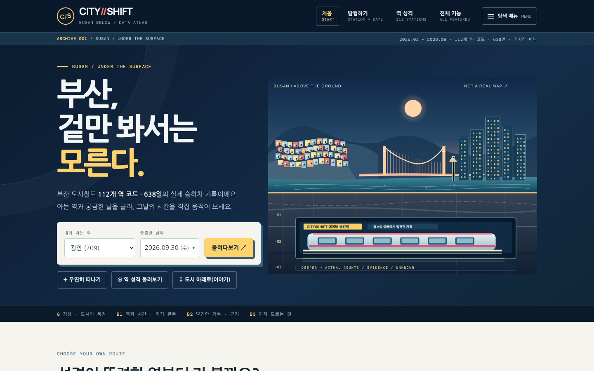
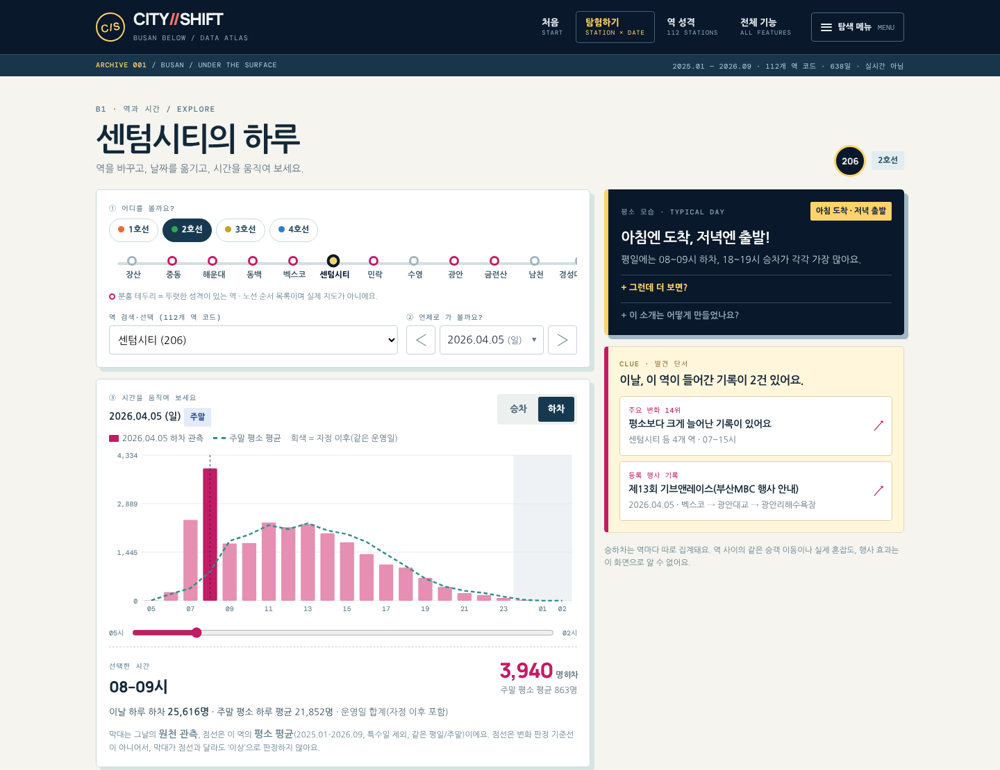
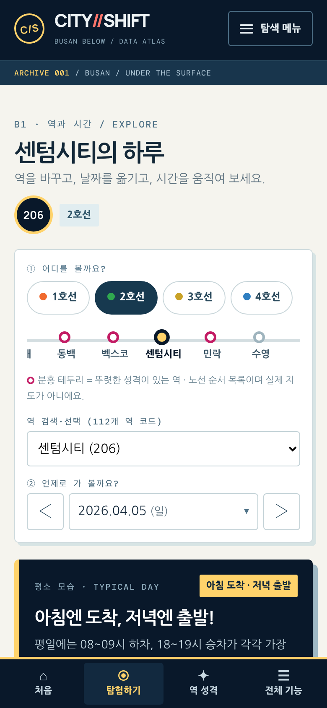
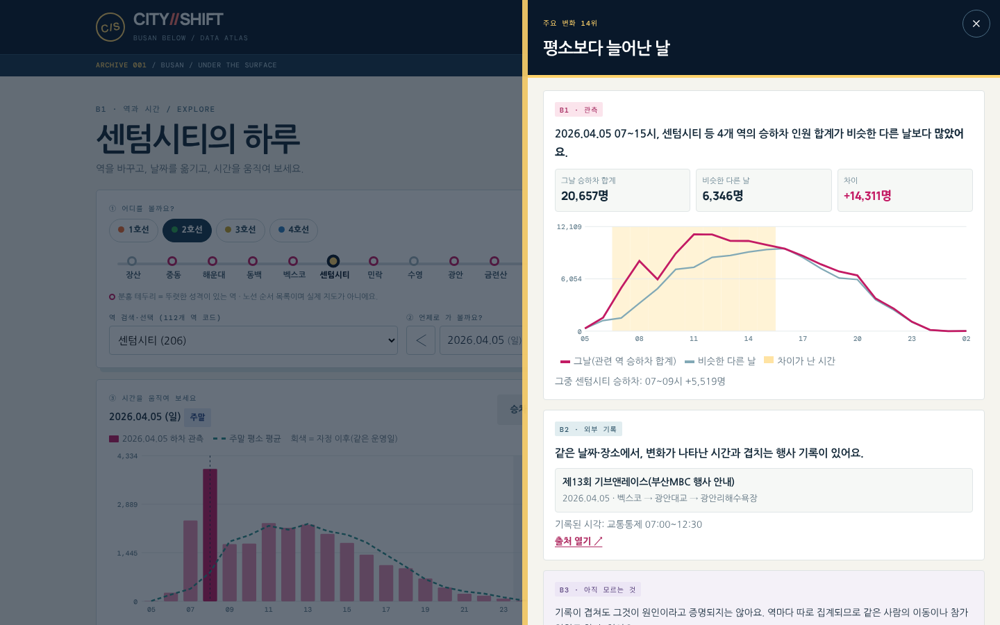
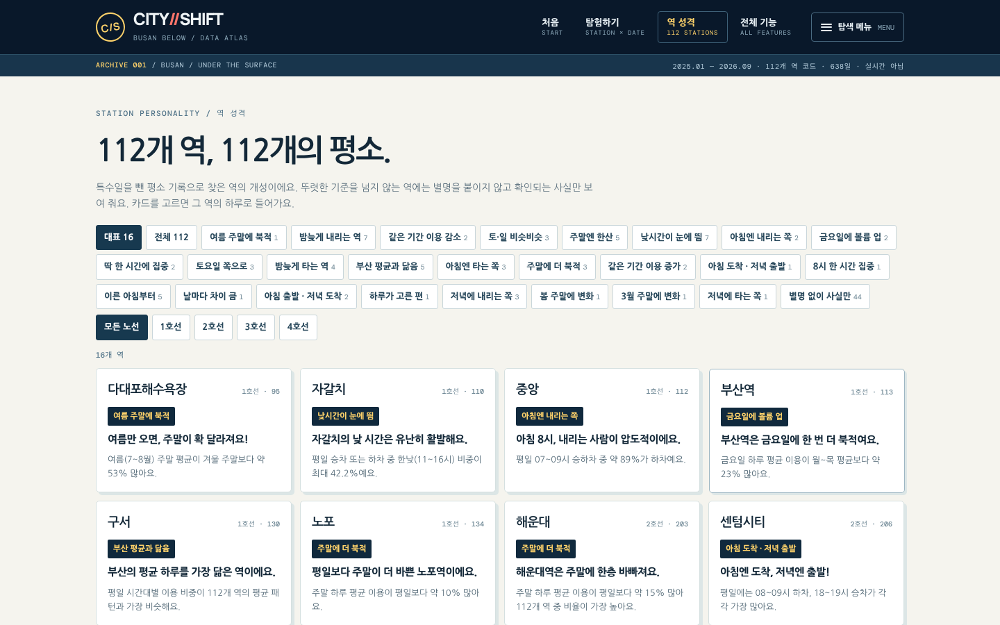
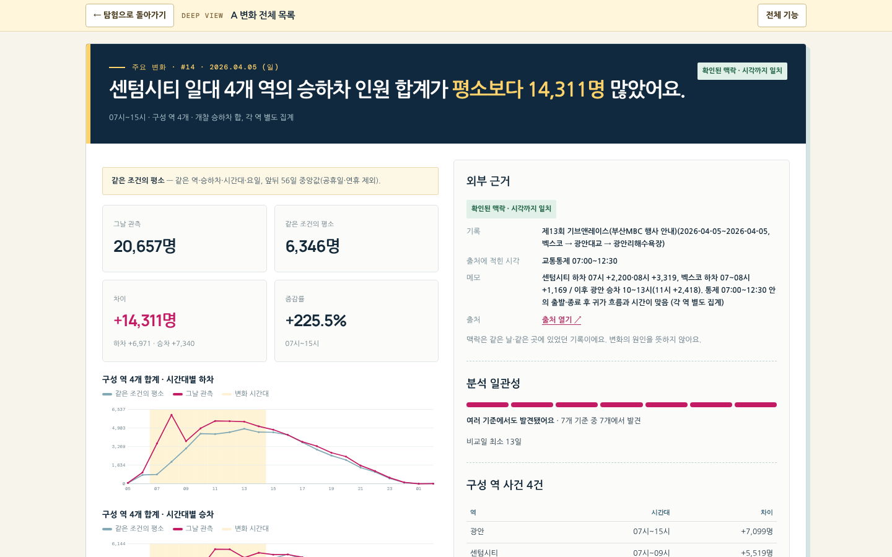
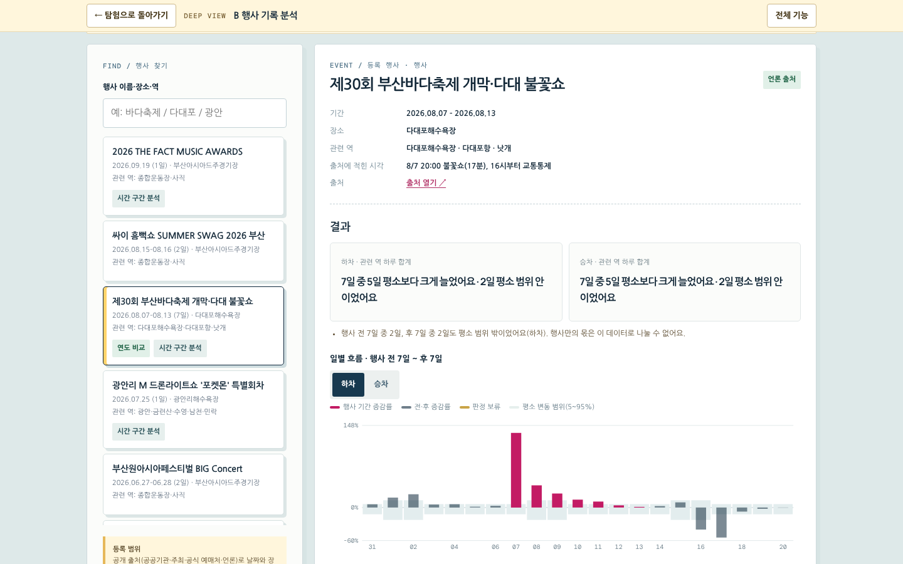
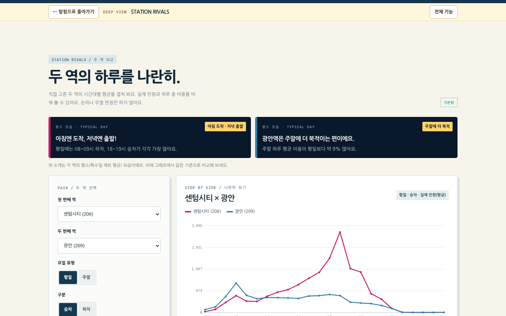
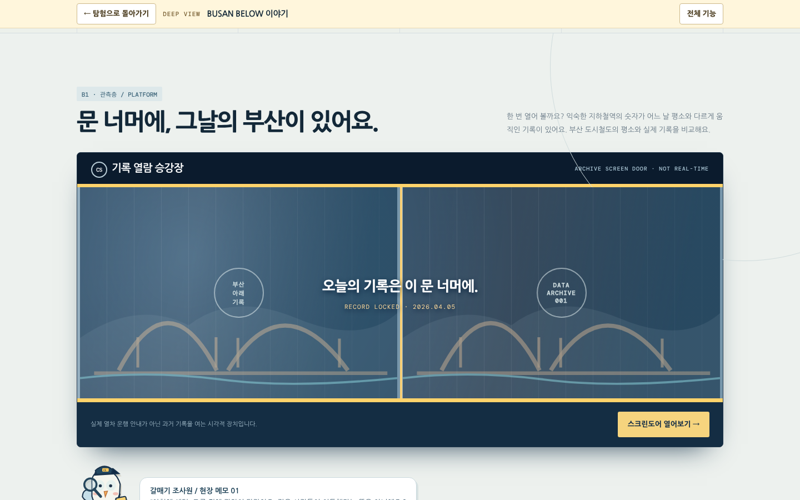
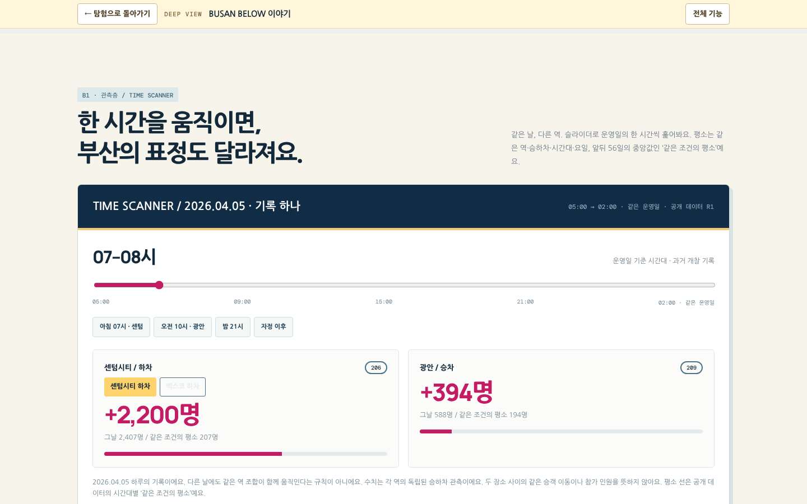

# 사용자 가이드

CITY//SHIFT에서 **무엇을 할 수 있고, 보이는 숫자를 어떻게 읽으면 되는지** 화면 순서대로 안내합니다.

서비스 주소: [https://justman-yzz.github.io/city-shift/](https://justman-yzz.github.io/city-shift/)

**먼저 알아 두면 좋은 것**

1. **실시간이 아닙니다.** 2025년 1월 1일 ~ 2026년 9월 30일의 기록입니다.
2. **숫자는 개찰구를 지난 횟수입니다.** 역마다 따로 세기 때문에 한 사람이 어디서 타서 어디서 내렸는지는 알 수 없고, 승차와 하차를 더한 값은 사람 수가 아닙니다.
3. **'평소와 다르다'는 판정은 정해진 화면(A·B)에서만 합니다.** 탐험 화면의 점선은 참고용 평균입니다.

## 목차

1. [처음 화면](#1-처음-화면)
2. [탐험하기 — 역의 하루](#2-탐험하기--역의-하루)
3. [단서 — 평소와 달랐던 기록](#3-단서--평소와-달랐던-기록)
4. [다음엔 어디로?](#4-다음엔-어디로)
5. [역 성격 112](#5-역-성격-112)
6. [심화 화면](#6-심화-화면)
7. [BUSAN BELOW 이야기](#7-busan-below-이야기)
8. [주소 공유와 키보드](#8-주소-공유와-키보드)
9. [자주 묻는 질문](#9-자주-묻는-질문)
10. [지원 환경](#10-지원-환경)

---

## 1. 처음 화면



가운데 상자에서 바로 시작합니다.

1. **내가 아는 역**에서 역을 고릅니다.
2. **궁금한 날짜**를 정합니다. 날짜는 `2026.04.05 (일)` 형식으로 보이고, 누르면 달력이 열립니다.
3. **들여다보기**를 누르면 그 역·그 날짜의 탐험 화면이 열립니다.

다른 입구

- **우연히 떠나기:** 역과 날짜를 무작위로 골라 줍니다.
- **역 성격 둘러보기:** 112개 역 코드의 평소 모습을 모아 봅니다.
- **도시 아래로(이야기):** 대표 기록 하나를 이야기처럼 따라갑니다.
- **성격이 뚜렷한 역** 카드 4장: 대표 역 16곳 중 4곳이 날마다 바뀌어 나옵니다.

## 2. 탐험하기 — 역의 하루





모바일에서는 역 선택 → 성격 카드 → 그래프 → 단서 → 다음 선택 순서로 세로로 이어지고, 화면 아래에 처음·탐험하기·역 성격·전체 기능 탭이 있습니다.

### 역 고르기

- **노선 칩(1~4호선)**을 누르면 아래 트랙에 그 노선 역이 순서대로 나옵니다. 분홍 테두리는 뚜렷한 성격이 있는 역입니다.
- 트랙은 노선 순서 목록이며 실제 지도가 아닙니다.
- 이름을 알면 **역 검색·선택** 목록에서 바로 고릅니다. 서면처럼 환승역은 노선별로 따로 있습니다.

### 날짜 옮기기

- ‹ › 버튼으로 하루씩 옮기거나 날짜 칸을 눌러 달력에서 고릅니다.
- 날짜 옆에 평일 / 주말 / 특수일(예: '특수일 · 설 연휴 블록')이 표시됩니다.

### 시간 움직이기

- **승차 / 하차** 버튼으로 방향을 바꿉니다.
- 슬라이더를 움직이거나 그래프 막대를 누르면 그 시간의 숫자가 바로 바뀝니다.
- 그래프는 **05시에서 시작해 다음 날 02시대까지** 그립니다. 오른쪽 회색 구간은 자정 이후입니다. 원천 자료가 이 시간을 그 밤이 시작된 날짜에 기록하기 때문입니다.

### 그래프 읽기

| 표시 | 뜻 |
|---|---|
| 막대 | 그날 그 시간의 **원천 관측** 인원 |
| 점선 | 이 역의 **평소 평균** — 2025.01~2026.09, 특수일 제외, 같은 평일/주말의 평균 |
| 진한 막대 | 지금 선택한 시간 |

점선은 판정 기준선이 아닙니다. 막대가 점선보다 높아도 그것만으로 '이상'이라는 뜻은 아닙니다. 그래프 아래에는 그날 하루 합계와 평소 하루 평균이 함께 나옵니다.

### 평소 모습 카드

오른쪽(모바일은 그래프 위) 남색 카드는 이 역의 성격입니다.

- **태그 → 한 줄 → 근거 숫자** 순서로 읽습니다. 예: '아침 도착 · 저녁 출발' / '아침엔 도착, 저녁엔 출발!' / '평일에는 08~09시 하차, 18~19시 승차가 각각 가장 많아요.'
- **그런데 더 보면?** 을 펼치면 반전이나 닮은 역 같은 보조 사실이 나옵니다.
- **이 소개는 어떻게 만들었나요?** 를 펼치면 계산 기준과 연구 분류가 나옵니다.
- 기준을 넘는 특징이 없는 역은 태그 없이 사실만 보여 줍니다.

## 3. 단서 — 평소와 달랐던 기록

그 역·그 날짜에 공개 기록이 **실제로 있을 때만** 'CLUE · 발견 단서'가 나옵니다.

- **A 기록:** 주요 변화·특별한 날짜·이용 감소 목록에 이 역이 들어간 날
- **B 기록:** 등록 행사가 이 역과 관련된 날

기록이 없으면 "이날 이 역에 연결된 공개 기록은 없어요. 평범한 하루도 관측이에요."라고 나오고, 이 역이 기록에 나온 다른 날로 가는 길을 안내합니다.

단서를 누르면 오른쪽에서 창이 열립니다.



| 칸 | 담긴 것 |
|---|---|
| **B1 · 관측** | 쉬운 한 문장, '그날 승하차 합계'와 '비슷한 다른 날'과 차이, 관련 역 합계 그래프(노란 띠 = 차이가 난 시간) |
| **B2 · 외부 기록** | 같은 날·같은 곳에 있었던 기록과 출처 링크, 그 기록이 얼마나 맞아떨어지는지 한 문장 |
| **B3 · 아직 모르는 것** | 이 데이터로 알 수 없는 것 |

- **분류·검증 기준 보기**를 펼치면 기록 번호, 외부 근거 등급, 기준선 정의, 분석 일관성이 나옵니다.
- A 기록의 '비슷한 다른 날'은 같은 역·시간대·요일의 앞뒤 56일 중앙값이고, B 기록은 '행사가 없던 평소'와 비교합니다. 두 기준은 다릅니다.
- 창 아래 버튼으로 전체 상세(A 상세, 행사 분석)로 갈 수 있습니다.
- Esc 키나 ✕ 버튼으로 닫습니다.

**외부 기록 문장 읽기**

| 문장 | 뜻 |
|---|---|
| 변화가 나타난 시간과 겹치는 행사 기록이 있어요 | 날짜·장소·시각이 모두 겹침 |
| 같은 날짜와 장소에서 열린 행사 기록이 있어요 | 출처에 시각이 없어 시각은 확인 못 함 |
| 관련 있을 수도 있는 기록이 있어요 | 날짜나 장소가 정확히 맞는지 확인 안 됨 |
| 설명할 기록은 아직 찾지 못했어요 | 찾아봤지만 없음 |
| 아직 찾아보지 않았어요 | 조사 전 |

어느 경우든 외부 기록은 '같은 때 이런 일이 있었다'는 뜻이고, 변화의 원인이라는 증명이 아닙니다.

## 4. 다음엔 어디로?

그래프 아래에 추천 카드가 **최대 3개** 나옵니다. 데이터로 연결이 확인된 것만 고릅니다.

1. **성격 연결:** 하루 모양이 정반대인 역 → 없으면 규모는 크게 다르지만 같은 성격인 역(의외의 공통점) → 없으면 가장 닮은 역
2. **같은 날, 다른 역:** 이날 같은 변화 기록에 함께 들어간 역이 있을 때
3. **같은 역, 다른 날:** 이 역이 공개 기록에 나온 날 가운데 지금 날짜와 가장 가까운 날

**+ 다른 탐험 보기**를 펼치면 다른 날짜, 관련 역 전체, 두 역 비교·역 프로필·원천 기록·변화 목록 바로가기가 나옵니다. 펼친 상태는 역을 바꿔도 유지됩니다.

'닮은 역'은 하루 시간대 모양이 비슷하다는 뜻입니다. 같은 승객이 두 역을 오간다는 뜻이 아닙니다.

## 5. 역 성격 112



- 처음에는 **대표 16곳**이 보입니다. 위 단추로 전체 112개, 태그별, 별명 없는 44개, 노선별로 거를 수 있습니다.
- 태그는 정해 둔 기준을 넘은 68개 역에만 붙습니다.
- 카드를 누르면 그 역의 탐험 화면으로 들어갑니다.

## 6. 심화 화면

머리글의 **전체 기능** 또는 **탐색 메뉴**에서 모든 화면으로 갈 수 있습니다. 심화 화면 위쪽의 '← 탐험으로 돌아가기'를 누르면 보던 탐험 화면으로 돌아옵니다.

### A 변화 목록



- **탭:** 주요 변화 50 · 도시 전체 변화 5 · 특별한 날짜 20 · 이용 감소 20
- **거르기:** 검색, 기간, 역(구성 역 기준), 외부 근거. 결과가 없으면 안내가 나옵니다.
- **상세:** 그날 관측·같은 조건의 평소·차이, 구성 역 합계의 시간대별 그래프, 외부 근거와 출처, 분석 일관성(기준 7가지 중 몇 번 다시 잡혔는지), 구성 역 표
- **근거 복사:** 수치와 한계를 함께 클립보드에 복사합니다. 파일을 직접 연 경우(`file://`)에는 브라우저 제한으로 직접 복사하라는 안내가 나올 수 있습니다.

'외부 기록 미검토'(점선 칩)와 '아직 설명되지 않음'은 다른 상태입니다.

### B 행사 분석



- 등록 행사 18건을 검색하고 고릅니다.
- **결과:** 행사 기간 동안 며칠이 평소보다 크게 늘었는지 / 평소 범위였는지
- **일별 흐름:** 행사 전 7일 ~ 후 7일의 증감률 막대와 평소 변동 범위(5~95%) 띠
- 비교할 평소 날이 1~7일이면 '판정 보류', 0일이면 '판정 불가'로 나옵니다.
- 출처에 시각이 있는 행사는 도착·귀가 시간 구간 판정을 따로 보여 줍니다.
- 같은 행사의 2025·2026 연도 비교 3건이 있습니다.

### 원천 관측 · CSV

- 역과 날짜를 골라 시간대별 원천 승하차 표를 봅니다.
- **CSV 불러오기:** 공공데이터포털에서 받은 부산교통공사 원천 CSV(UTF-8·CP949) 또는 화면에 안내된 형식의 CSV를 불러올 수 있습니다. 파일은 브라우저 안에서만 읽고 외부로 보내지 않습니다.

### 역 프로필

평일/주말, 승차/하차별 시간대 평균과 정점, 주말/평일 비율, 이 역이 들어간 A 기록, 성격 카드.

### 두 역 비교 (STATION RIVALS)



- 두 역을 골라 하루 모양을 겹쳐 봅니다. 위에는 두 역의 성격 카드가 나란히 나옵니다.
- 평일/주말, 승차/하차, 실제 인원(평균)/하루 중 비중을 바꿀 수 있습니다.
- 같은 역을 두 번 고를 수 없고, 합산 집계역(수영·미남)은 안내가 나옵니다.

### 데이터 출처·한계

자료 기간, 집계 단위, 서로 다른 세 가지 '평소', 이 데이터로 알 수 없는 것을 정리한 화면입니다.

## 7. BUSAN BELOW 이야기

2026년 4월 5일 센텀시티·벡스코·광안·해운대의 기록 하나를 지층처럼 따라 내려갑니다.

| 층 | 구역 | 하는 일 |
|---|---|---|
| G | 도시 단면 | 지층 안내 |
| B1 | 스크린도어 | 문을 열어 그날의 기록을 봄 |
| B1 | 시간 스캐너 | 한 시간씩 움직이며 역·방향별로 그날과 같은 조건의 평소를 비교 |
| B2 | 근거층 | 외부 기록과 관측이 겹치는 정도 |
| B3 | 미지층 | 아직 알 수 없는 질문 |
| — | 대표 변화 상세 | 수치, 구성 역, 근거 복사 |





시간 스캐너는 **그날 하루의 기록**입니다. 다른 날에도 같은 역들이 함께 움직인다는 규칙이 아닙니다.

## 8. 주소 공유와 키보드

**주소 공유.** 탐험 화면의 주소에는 역·날짜·승하차·시간이 들어 있어, 복사해 보내면 같은 화면이 열립니다.

```
https://justman-yzz.github.io/city-shift/#/explore?s=206&d=2026-04-05&g=a&h=3
→ 센텀시티 · 2026.04.05 · 하차 · 08–09시
```

잘못된 역이나 기간 밖 날짜가 들어오면 기본값으로 열리고, 없는 주소는 처음 화면으로 갑니다. 뒤로/앞으로 버튼으로 이전 역·날짜를 오갈 수 있습니다.

**키보드**

| 동작 | 키 |
|---|---|
| 역 트랙의 역 고르기, '다른 탐험 보기' 펼치기, 단서 열기 | Enter |
| 시간 슬라이더, 날짜 칸 | ← → / ↑ ↓ |
| 단서 창·탐색 메뉴 닫기 | Esc (닫으면 원래 버튼으로 돌아감) |

단서 창이 열려 있는 동안 Tab 이동은 창 안에서만 돕니다.

## 9. 자주 묻는 질문

**지금 역이 붐비는지 알 수 있나요?**
아니요. 2026년 9월 30일까지의 과거 기록입니다.

**'112개 역 코드'라고 쓰는 이유는?**
환승역은 노선마다 코드가 따로 있고, 수영·미남은 두 노선이 한 코드로 합쳐져 있어서 실제 역 수와 다르기 때문입니다.

**경전철·동해선은 왜 없나요?**
원천 자료(부산교통공사 1~4호선)에 포함되지 않습니다.

**사직·종합운동장 쪽 변화는 왜 A 목록에 없나요?**
이 일대 7개 역은 정기 행사가 잦아 평소 기준을 검증하는 중이라, 이 역들을 중심으로 한 지역 변화는 A 목록에서 뺐습니다. 이 권역의 등록 행사는 B 행사 분석에서 볼 수 있습니다.

**그래프 대신 'CSV를 불러와 보세요'라는 안내가 나와요.**
페이지에 압축해 넣은 원천 기록을 푸는 브라우저 기능(`DecompressionStream`)이 없는 경우입니다. 브라우저를 최신 버전으로 바꾸거나, 원천 관측·CSV 화면에서 원천 CSV를 불러오세요. 다른 화면은 그대로 쓸 수 있습니다.

**예전 화면이 보여요.**
브라우저가 이전 판을 최대 10분 동안 기억할 수 있습니다. 새로 고침하거나 서비스 첫 주소([https://justman-yzz.github.io/city-shift/](https://justman-yzz.github.io/city-shift/))로 들어가면 최신 판이 열립니다.

## 10. 지원 환경

| 환경 | 상태 |
|---|---|
| 데스크톱 Chromium 계열, 화면 폭 1440px·390px | 자동 검사함 |
| 터치 입력(390px, 터치 기기 흉내) | 자동 검사함 |
| iPhone Safari, 삼성 인터넷 실기기 | **아직 검사하지 않음** |
| Firefox | 검사하지 않음 |

코드에 쓰인 기능으로 본 예상 최소 버전은 Safari·iOS 16.4, 삼성 인터넷 14입니다. 그보다 낮으면 탐험 그래프 대신 CSV 안내가 나올 수 있습니다. 인터넷 연결이 없으면 지정 글꼴 대신 시스템 글꼴로 보이며 기능은 그대로입니다.
